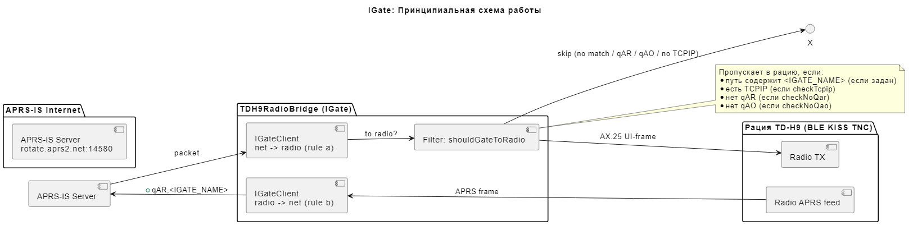
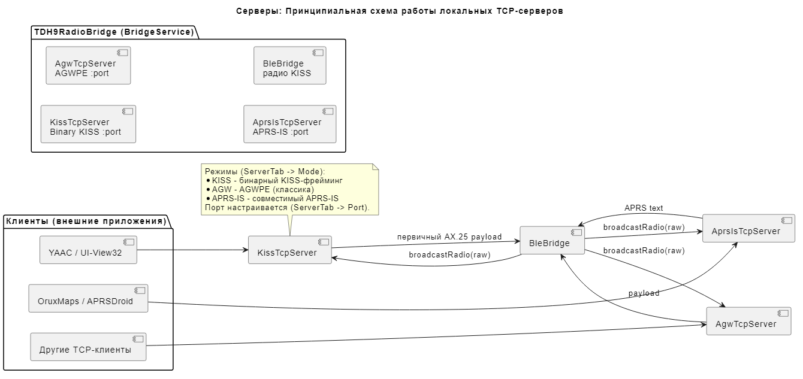
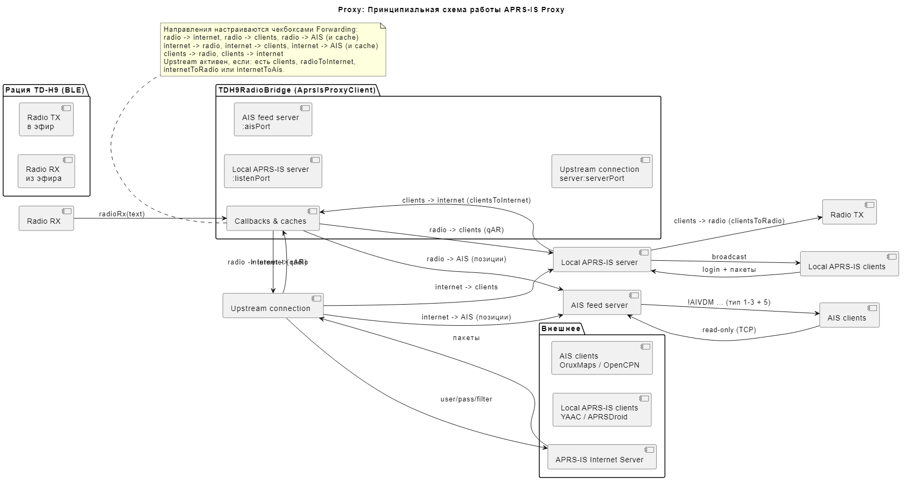
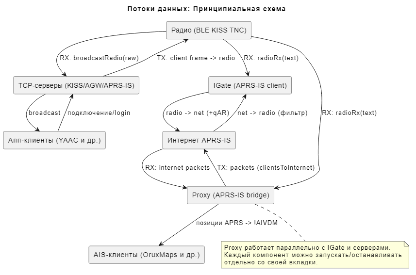
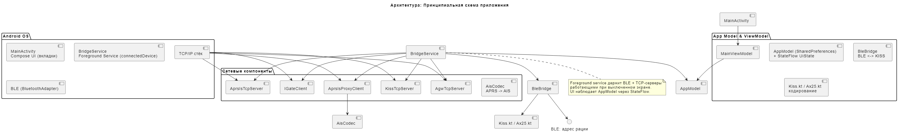
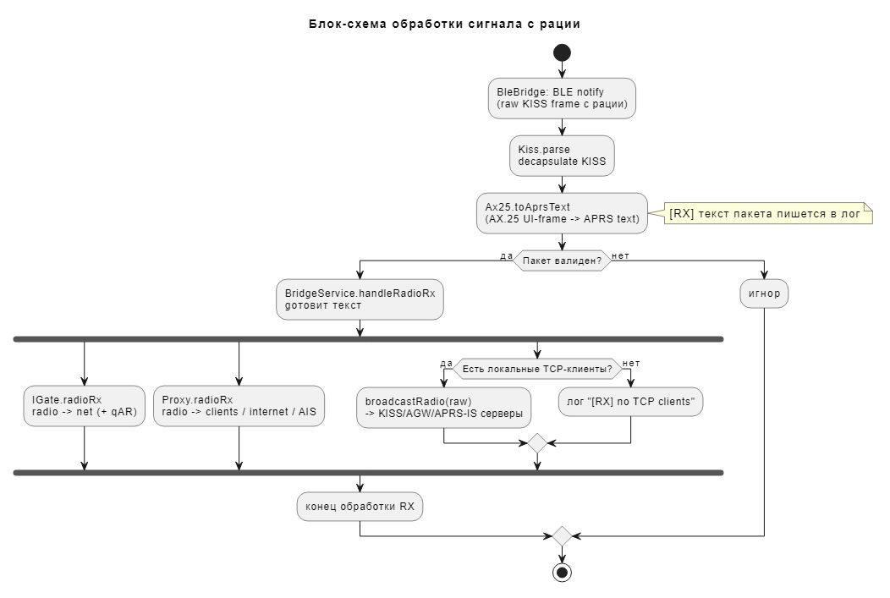
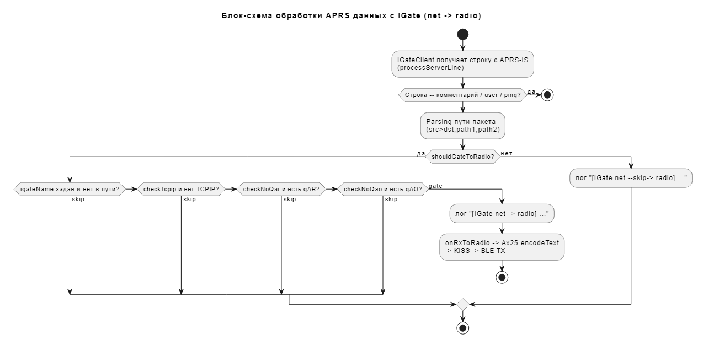
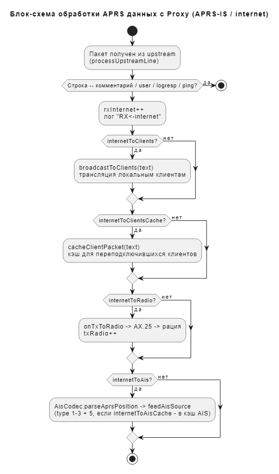
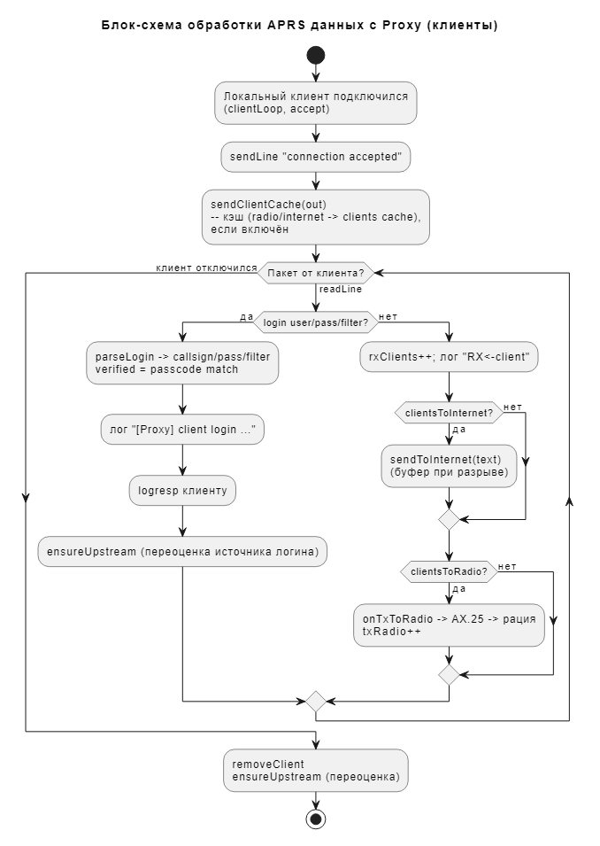

# HOWTO: TDH9RadioBridge - detailed instructions for use

**Version of document:**appendix**v1.2. 0**

TDH9RadioBridge - the bridge between the radio**TIDRadio TD-H9**and external APRS applications through local TCP servers, as well as a gateway to the APRS-IS (IGate) and APRS-IS Proxy Internet network with AIS feed.

---

## Contents

* [Description of tabs](#описание-вкладок)
* [Description of fields](#описание-полей)
* [Description of checkboxes](#описание-чекбоксов)
* [Description of buttons](#описание-кнопок)
* [Description of the dens](#описание-логов)
* [Permit requirements n](#требования-к-разрешениям)
* [Requirements to enable Bluetooth and GPS](#требования-к-включению-bluetooth-и-gps)
* [Working principle](#принцип-работы)
* [The principle of routing IGate packets: radio → Internet](#принцип-маршрутизации-пакетов-igate-рация--интернет)
* [Principle of routing IGate packets: Internet → radio](#принцип-маршрутизации-пакетов-igate-интернет--рация)
* [Principle and settings for routing Proxy packets](#принцип-и-настройки-маршрутизации-пакетов-proxy)
* [Schemes (PlantUML)](#схемы-plantuml)

---

## Description of tabs

The application consists of 6 tabs (lower navigation):

| # | Tab | Appointment |
| --- | --- | --- |
| 0 | **Radio Radio** | BLE device scanning, radio connection, connection history, list of services found |
| 1 | **Server** | Local TCP servers (KISS / AGW / APRS-IS): mode, port, start/stop, list of connected clients, local addresses |
| 2 | **IGATE** | Gateway between radio and APRS-IS Internet network: login settings, filters, start/stop |
| 3 | **Proxy** | APRS-IS Proxy: upstream settings, spread directions, AIS feed, statistics, clients, packet log |
| 4 | **Log.** | Application Event Log (BLE, servers, IGate, Proxy) with time stamps, limiting 200 messages |
| 5 | **About** | About the program: version, author, links, export/import settings, full output |

### Radio tab (0)

* **Scan**Starting a BLE scan of radios around.
* **Disconnect**- off the current radio.
* List of found devices – cards with name, address (MAC) and signal level (RSSI). Tap on card - connection.
* **History (previously connected)**Last connected devices (up to 10), tap – fast connection.
* **Found**A list of BLE services found on the radio after connection.

**How to connect to the device (step by step):**

1. **Turn on Bluetooth.**on the phone and BLE/APRS mode on the radio (the radio should be turned on, next to the phone).
2. Turn it on.**Positioning**(Location) on the phone – without it, BLE scanning on Android does not work (the app itself does not need GPS). On the first scan, the app will ask for Bluetooth permissions and location — allow.
3. On the tab.**Radio Radio**press**Scan**. While scanning, the button shows the state of “Scanning...”
4. Wait for the radio to appear in the list of found devices (name, MAC address, signal level)`RSSI, dBm`). The closer the radio, the better the RSSI.
5. **Put it on the card.**radios in the "Scan" list (or in "History (previously connected)" for quick reconnection) - the application will start connecting over BLE.
6. With a successful connection, a card will appear at the top.**Connected: <name> (<address>)**And in the log,`[BLE] Connected ...`. You can then run servers/IGate/Proxy on other tabs.
7. Press to shut down.**Disconnect**.

**If the radio is not available:**Check that Bluetooth and Location are on and the radio is close.
- Press it.**Scan**Repeat (sometimes you need a second scan).
Check that the radio is in BLE/APRS mode and is not connected to another device.

### Server tab (1)

Launch.**single**local TCP server of the selected mode. Through it, external APRS applications (YAAC, UI-View32, APRSDroid, etc.) communicate with the radio.

* **Mode**Select the server mode (KISS / AGW / APRS-IS).
* **Port Port Port**A TCP port that listens to the server.
* **Start server / Stop server**- management.
* **Server local addresses**IP addresses of the device (Wi-Fi/LAN) by which clients connect to the server.
* A list of connected customers.

**Detailed description of server operation modes:**

Choose.**Mode**and press**Start server**. Only one server works at a time (starting a new one stops the previous one). The default port is**8023**(for KISS/AGW), 14580 for APRS-IS; configured in the field**Port Port Port**. Customer connection is possible only when the phone and client are on the same network (see "Server local addresses").

| Regime. | Protocol | Data format | Who's right? |
| --- | --- | --- | --- |
| **KISS** | Binary KISS (TNC2) | Raw KISS frames:`FEND ... FEND`around the AX.25 frames | Any software that can work with KISS-TNC (YAAC, UISS, UI-View32, direwolf clients, APRSDroid via KISS-TCP) |
| **AGW** | AGWPE (AGW Packet Engine TNC Interface) | 36-byte header + data; version/port/registration requests | Classic Windows programs (UI-View32, AGWTRACKER) and everything that says AGWPE |
| **APRS-IS** | APRS-IS text (as on real server port 14580) | Lines.`user ...`/`logresp`/packages`CALL>DST,path:data` | Programs that can connect to the APRS-IS server (APRSDroid, YAAC, Direwolf in IG-client mode) |

**KISS mode:**- The radio is presented as**KISS TNC on top of TCP**The client sends KISS frames (data) to TX, receives radio packets wrapped in KISS frames.
- KISS teams`CMD_DATA`The payload (AX.25 payload) is transferred to the BLE radio.
- Default port:**8023**.

**AGW mode (AGWPE):**- Implementing protocol.**AGW Packet Engine**(default port)**8000**in classics, including queries: version`R`), port information (`G`), possibilities (`g`), registration (`X`), monitoring (`m`), dispatch (`K`/`k`/`V`/`M`).
Customers with monitor rights receive all radio traffic; the transmission is through AGW frames.
- Suitable for software that works "through AGWPE".

**APRS-IS mode:**- Emulating.**APRS-IS server**: client logs in line`user CALL pass PASSCODE vers ...`gets`# logresp CALL verified/unverified, server ...`.
-**Passcode verification is mandatory**(Standard APRS-IS Algorithm): With the correct password, the client is marked as`verified`, and the list of customers is displayed`aprs://CALL@ip:port/tx`; in the unfaithful,`.../rx`(read-only)
- If the client didn't send.`user ...`its callsign is determined by the first package (`CALL>DST,...`).
Packages from a client are encoded back into binary AX.25 and transmitted to a walkie-talkie; radio packets are broadcast to customers as text strings.
- Default port:**14580**.

**Common to all regimes:**Broadcast from the radio goes to all connected customers (broadcast).
The list of clients and their number are visible on the Server tab.
To connect external software, use the IP from “Server local addresses” and the selected port (for example,`192.168.1.20:8023`).

### IGate tab (2)

Independent gateway "radio air я APRS-IS" (network port). Connects to the APRS-IS Internet server as a client and broadcasts packets in both directions according to the rules.

* Field`APRSIS_CLIENT`, `IGATE_NAME`, `Passcode`, `Server`, `Port`, `Filter`.
* Checkboxes`Require TCPIP`, `Reject qAR`, `Reject qAO`.
* **Start IGate / Stop IGate**.

### Proxy tab (3)

APRS-IS Proxy is a local APRS-IS server + upstream connection + AIS feed. It differs from IGate in that it is**server for local clients**And it connects them with the Internet and radio (directions are configured).

* Upstream settings (callsign/pass/server/ports/filter/igateName/credentials)
* Group**forwarding**Direction checkboxes (see below).
* **AIS feed**Enabling the AIS server and its port.
* **Timing.**The ping/cache/idle intervals.
* Packet counters, list of active customers, log of the last 20 packages.
* **Start Proxy / Stop Proxy**, **Reset stats**, **Clear cache**, **Clear.**.

### Log tab (4)

Journal of all events with time stamps`HH:mm:ss`. Each line is an event from one of the components:`[BLE]`, `[RX]`, `[KISS <-]`, `[AGW]`, `[APRS-IS]`, `[IGate ...]`, `[Proxy ...]`, `[AIS ...]`, `[Settings ...]`, `[Server]`.

* **Clear.**- clear the journal.
* Not more than 200 last messages (protection from memory jam).

### Tab About (5)

* Application version, author, links to repositories.
* **Export settings (JSON)** / **Import settings (JSON)**Export/import all settings to the file`TDH9RadioBridgeBackup.json`through folder system selection.
* **Exit application**Full exit from the application (closes the background service).

---

## Description of fields

### Server (Server tab)

| Field. | Description |
| --- | --- |
| **Mode** | Local TCP server mode:`KISS`(KISS binary),`AGW`(AGWPE),`APRS-IS`(compatible text). |
| **Port Port Port** | TCP server port (by default)**8023**). |

### IGate (IGate tab)

| Field. | Description | By default. |
| --- | --- | --- |
| **APRSIS CLIENT** | Callsign that IGate logs into APRS-IS (usually)`NOCALL-10`, for work, my own. | `NOCALL-10` |
| **Ilate NAME** | Call sign shown to the network as the name IGate; added to the packet path as`,qAR,<IGATE_NAME>`. | `NOCALL-1` |
| **Passcode** | APRS-IS password for callsign.`0`Calculate automatically (aprslib algorithm). | `0` |
| **Server** | APRS-IS Internet server host. | `rotate.aprs2.net` |
| **Port Port Port** | APRS-IS server port. | `14580` |
| **Filter** | Subscription on the server, for example`d/NOCALL*`. Empty - filter`d/<IGATE_NAME> *`. | empty |

### Proxy (Proxy tab)

| Field. | Description | By default. |
| --- | --- | --- |
| **Callsign (upstream)** | Call sign for upstream login when the source`OWN`Or no customers. | `NOCALL-10` |
| **Passcode (0 = auto)** | Password.`0`- Autocomputing. | `0` |
| **Server** | Upstream APRS-IS host. | `rotate.aprs2.net` |
| **Server port (upstream APRS-IS)** | Port of APRS-IS Internet Server. | `14580` |
| **Client port (local listener)** | Port local APRS-IS server for clients. | `14580` |
| **Filter** | Upstream filter (by default)`d/<IGATE_NAME> *`). | empty |
| **Ilate NAME** | Call sign for correction`,qAR,<IGATE_NAME>`I'll go outside. | `NOCALL-1` |
| **Credentials** | Source of the upstream creed:`OWN` / `FIRST_CLIENT` / `LAST_CLIENT`by default**FIRST CLIENT**). | FIRST CLIENT |
| **AIS port** | AIS feed TCP port for AIS clients. | `10110` |
| **Ping (s)** | Keepalive-ping interval (upstream and local customers) | `90` |
| **Cache (s)** | Lifetime of packet/position cache. | `90` |
| **Idle timeout (s)** | After how many seconds to close upstream without demands. | `300` |

---

## Description of checkboxes

### IGate (IGate tab)

| checkbox | Description |
| --- | --- |
| **Requirement TCPIP** | Pass the packet on the radio only if on the way`TCPIP`. |
| **Reject qAR** | Do not pass on the radio packets containing`qAR`. |
| **Reject qAO** | Do not pass on the radio packets containing`qAO`. |

### Proxy - Forwarding (Proxy tab)

Grouped by source:

**radio:**| Checkbox | Description |
|--------|----------- |
|**radio - Internet**| Packages from the radio go to the Internet APRS-IS (c)`,qAR`). |
|**radio -> clients**| Packages from the radio are broadcast to local APRS clients. |
|**radio -> clients cache**| Cache packets from the radio for newly connected customers (TTL = Cache). |
|**radio -> ais**| From the radio packets, positions are allocated and left to AIS clients. |
|**radio -> ais cache**| Caching AIS positions from radio for reconnection. |

**Internet:**| Checkbox | Description |
|--------|----------- |
|**Internet -> radio**| Packages from the Internet are transmitted to the radio. |
|**Internet -> clients**| Packages from the Internet are broadcast to local customers. |
|**Internet -> clients cache**| Cache Internet packages for newly connected customers. |
|**Internet -> ais**| Positions from Internet packages go to AIS clients. |
|**Internet -> ais cache**| Caching AIS positions from the Internet. |

**clients:**| Checkbox | Description |
|--------|----------- |
|**clients -> radio**| Packages from local customers are sent to the radio. |
|**clients**| Packages from local customers go to the Internet (buffered when broken). |
|**apply,qAR,radio out**| add`,qAR,<IGATE_NAME>`c radio packets before being sent out. |

### Proxy - AIS feed

| checkbox | Description |
| --- | --- |
| **Enabled AIS** | Enable the AIS server on the port`AIS port`. |

---

## Description of buttons

| Button | Where | Action. |
| --- | --- | --- |
| **Scan** | Radio Radio | Launching a BLE scan. |
| **Disconnect** | Radio Radio | Turn off the radio. |
| **Start server** | Server | Save settings and start the TCP server. |
| **Stop the server.** | Server | Shut down the server. |
| **Start IGATE** | IGATE | Save the settings and start IGate. |
| **Stop IGATE** | IGATE | Stop IGate. |
| **Start Proxy** | Proxy | Save settings and run a proxy (server + upstream + AIS). |
| **Stop Proxy.** | Proxy | Stop the proxy. |
| **Reset stats** | Proxy | Zero packet counters and log. |
| **Clear cache** | Proxy | Clear all caches (customer packets + AIS positions) without touching the counters. |
| **Clear.** | Proxy (packet log) | Clear the last packet log. |
| **Clear.** | Log. | Clear the event log. |
| **Export settings (JSON)** | About | Select a folder (system dialogue) and write down`TDH9RadioBridgeBackup.json`. |
| **Import settings (JSON)** | About | Select a folder and read`TDH9RadioBridgeBackup.json`. |
| **Exit application** | About | Complete exit from the app. |

---

## Description of the dens

All events are written on a tab.**Log.**time-marked`HH:mm:ss`, maximum 200 lines.

**Prefixes:**

| Prefix | Contents |
| --- | --- |
| `[BLE] ...` | BLE status, scan results, connection/disconnection, services, Bluetooth errors. |
| `[RX] ...` | Text of the package received from the radio. |
| `[KISS <-]` / `[AGW <-]` / `[APRS-IS <-]` | A packet received from the TCP client of the respective server. |
| `[Server] ...` | Start/stop servers, ports. |
| `[IGate ...]` | APRS-IS connection, login, errors,`radio -> net` / `net -> radio` / `net --skip-> radio`. |
| `[Proxy ...]` | Start/stop, customer connections, login, upstream, flush cache, idle-closing. |
| `[Proxy!] ...` | Proxy errors (listen, accept, upstream, radioRx, tx) |
| `[AIS ...]` | AIS server: listener, connection / disconnection of clients. |
| `[AIS!] ...` | AIS server errors. |
| `[Settings] / [Settings!]` | Export/import settings (success/errors) |
| `[RX] no TCP clients connected, skip broadcast` | There is a radio package, but there are no clients to the servers - the broadcast is missed. |

An example of IGate's work in the log:

```
12:00:01 [IGate] connecting to rotate.aprs2.net:14580 as TEST-10
12:00:01 [IGate] login: user TEST-10 pass 12345 vers TDH9KissIGate v1.0 filter d/TEST*
12:00:05 [RX] TEST-10>APTT4,TCPIP*:@120005z5500.00N/03700.00E_...
12:00:05 [IGate radio -> net] TEST-10>APTT4,TCPIP*:...  ->  TEST-10>APTT4,TCPIP,qAR,TEST-1*:...
12:00:20 [IGate net -> radio] OTHER>APRS,TCPIP*:...
```

---

## Permit requirements n

When requesting permission, the button interface**Scan**It will show you what permissions are required.

| Permission | For what? |
| --- | --- |
| `BLUETOOTH_CONNECT` | Connect to the radio (Android 12+) |
| `BLUETOOTH_SCAN` | BLE scanning (Android 12+) |
| `BLUETOOTH` / `BLUETOOTH_ADMIN` | Classic Bluetooth (up to Android 12). |
| `ACCESS_FINE_LOCATION` / `ACCESS_COARSE_LOCATION` | Android is required for BLE scanning (scanning equates to geolocation). They are not used to determine location. |
| `FOREGROUND_SERVICE` + `FOREGROUND_SERVICE_CONNECTED_DEVICE` | Keep the service (BLE + TCP + IGate + Proxy) running while the screen is off. |
| `WAKE_LOCK` | Do not let the device “fall asleep” during active operation. |
| `INTERNET` / `ACCESS_NETWORK_STATE` | IGate and Proxy (connection to APRS-IS, servers). |
| `POST_NOTIFICATIONS` | Background service notification (Android 13+) |

## Requirements to enable Bluetooth and GPS

1. **Bluetooth should be on.**on the phone (fast access – Bluetooth icon).
2. If the scan doesn't find the radio:
3. Make sure the radio is on BLE/APRS mode (see TD-H9); the radio should be “by ear”, not too far from the phone.
4. Restart the scan (button)**Scan**).
5. **GPS/location**:
6. The GPS app itself.**needlessly**(It does not specify the coordinates).
7. But on Android.**BLE scanning requires enabled location service**Location, otherwise the scan will not return the device.
8. Enable: Settings → Location → On (and allow the app “when used”). Accuracy is not important, you can only "device".
9. After scanning, choose a walkie-talkie from the list (or from the history) - tap by card.

---

## Working principle

The application works through**background-service**(BridgeService):

1. **BLE bridge**Connects to the TD-H9 radio via Bluetooth LE (service)`0000af00`KISS framing. Incoming radio frames are decoded from KISS → AX.25 → APRS text; outgoing ones are encoded back.
2. **Local TCP servers**(Server tab) allows external APRS applications to work with the walkie-talkie as with TNC: they see the flow of packets and can send their own.
3. **IGATE**works in parallel with the APRS-IS network: ether packets go to the network, network (passed filter) - to the air.
4. **Proxy**It works as a server for local APRS clients + a bridge to the Internet + an AIS feed generator.
5. All state (devices, servers, settings, log) lives in a single`AppModel`(StateFlow), UI - in Compose tabs.

Process diagrams - in the section[Schemes (PlantUML)](#схемы-plantuml).

---

## The principle of routing IGate packets: radio → Internet

1. From the radio comes AX.25 UI frame → decoded into text`[RX] ...`).
2. `IGateClient.radioRx(text)`:
3. If the APRS-IS connection is not available or the IGate is turned off, the packet does not leave.
4. Otherwise, the package path is added`,qAR,<IGATE_NAME>`(if there is one in the title)`>`);
5. The package is sent to the APRS-IS socket.
6. It's a log.`[IGate radio -> net] <исходный> -> <с qAR>`.

Scheme:`Manual/igate_principle.png`.

## Principle of routing IGate packets: Internet → radio

1. The APRS-IS socket reads a line (`processServerLine`).
2. Service lines`#`, `user ...`, `ping`) are ignored.
3. The decision to walk or not.`shouldGateToRadio`:
4. if`IGATE_NAME`And he's not on the way.
5. if`Require TCPIP`Not on the way.`TCPIP`- skip?
6. if`Reject qAR`is`qAR`- skip?
7. if`Reject qAO`is`qAO`- Skip.
8. If all the checks are passed, the text is encoded back into the AX.25 UI frame, wrapped in KISS and transmitted via BLE to the radio. In the log--`[IGate net -> radio] ...`; at skip --`[IGate net --skip-> radio] ...`.

Block diagram:`Manual/igate_aprs_flow.png`.

---

## Principle and settings for routing Proxy packets

Proxy (inlay)**Proxy**) is a local APRS-IS server (`Client port`), which:

* Accepts local APRS-IS clients (YAAC/APRSDroid, etc.);
* keeper**single**upstream connection to real APRS-IS`Server`, `Server port`), the login is taken from**Credentials**(OWN/first/last connected client)
* Spraying packages in all directions (checkboxes)**forwarding**);
* generate**AIS feed**Positions from radio/internet packets turn into NMEA`!AIVDM`(type 1-3 + static 5) and broadcast to AIS clients (OruxMaps/OpenCPN)`AIS port`;
* **upstream active**If: There are connected clients**or**included`radio -> internet` **or** `internet -> radio` **or** `internet -> AIS`.

Scheme:`Manual/proxy_principle.png`.

---

## Schemes (PlantUML)

All the circuits are in the folder.**`Manual/`**(pictures)`.png`source`.puml`).

| Scheme. | File. |
| --- | --- |
| Principal scheme of work of IGate |  |
| Principal scheme of work of servers |  |
| Principal scheme of work Proxy |  |
| Principle chart of data flows |  |
| The principle scheme of architecture |  |
| Block diagram of signal processing from the radio |  |
| APRS data processing block diagram with IGate |  |
| APRS data processing block diagram with Proxy APRS-IS |  |
| APRS data processing block diagram with Proxy customers |  |