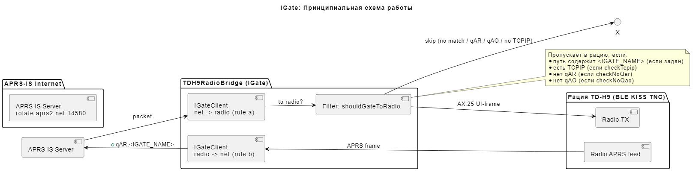
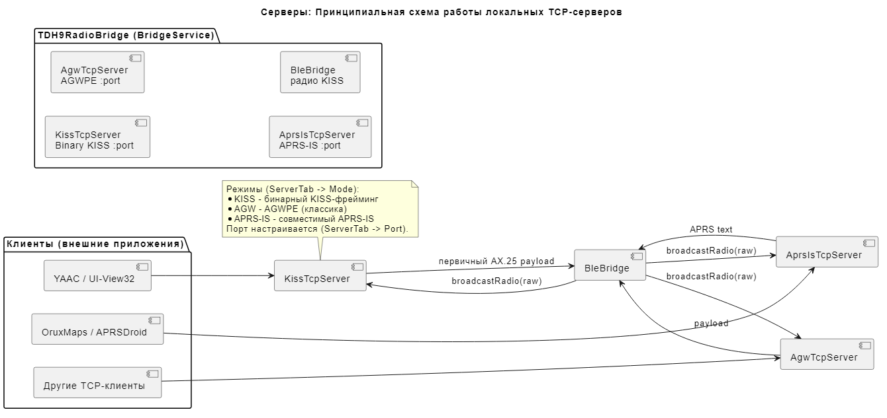
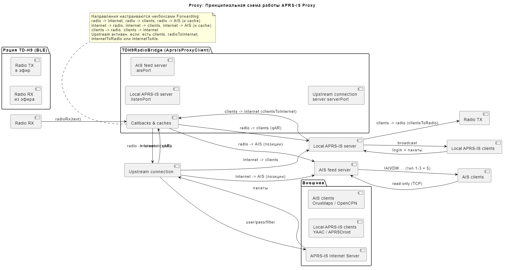
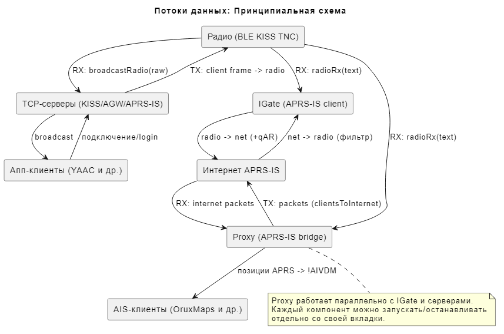
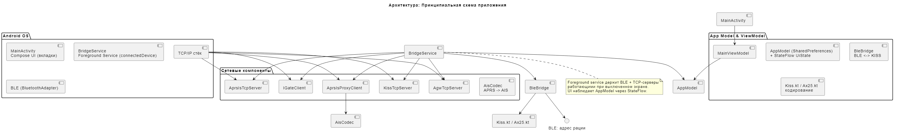
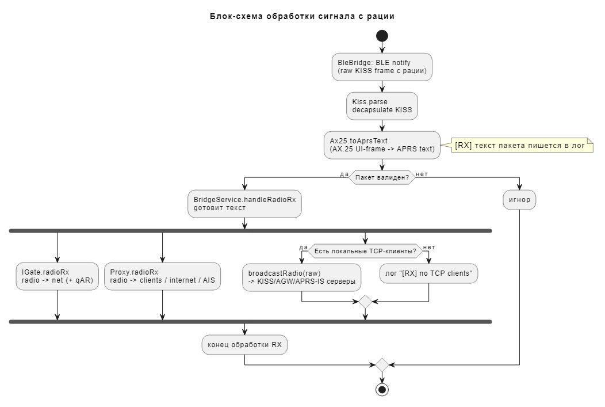
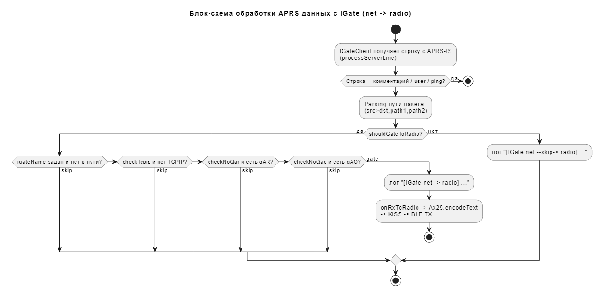
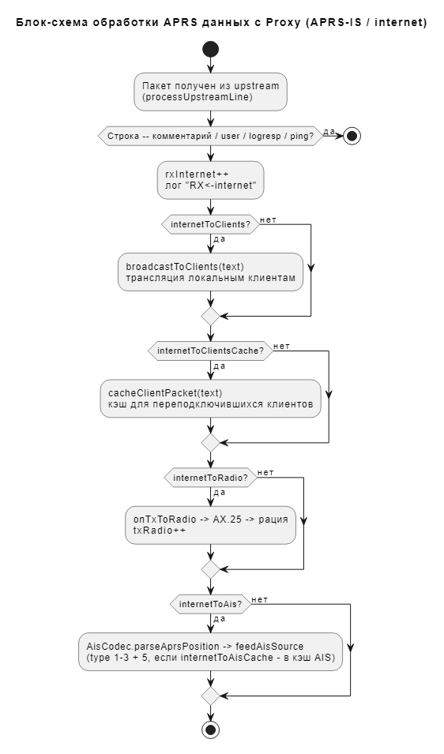
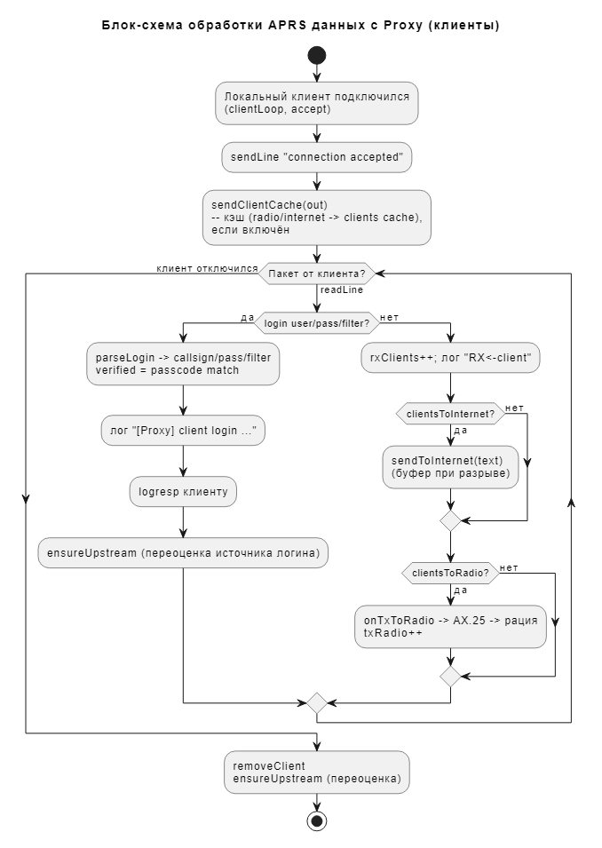

# HOWTO: TDH9RadioBridge — подробная инструкция по использованию

**Версия документа:** соответствует приложению **v1.2.0**

TDH9RadioBridge — мост между рацией **TIDRadio TD-H9** и внешними APRS-приложениями через локальные TCP-серверы, а также шлюз в интернет-сеть APRS-IS (IGate) и APRS-IS Proxy с фидом AIS.

---

## Содержание

- [Описание вкладок](#описание-вкладок)
- [Описание полей](#описание-полей)
- [Описание чекбоксов](#описание-чекбоксов)
- [Описание кнопок](#описание-кнопок)
- [Описание логов](#описание-логов)
- [Требования к разрешениям](#требования-к-разрешениям)
- [Требования к включению Bluetooth и GPS](#требования-к-включению-bluetooth-и-gps)
- [Принцип работы](#принцип-работы)
- [Принцип маршрутизации пакетов IGate: рация → интернет](#принцип-маршрутизации-пакетов-igate-рация--интернет)
- [Принцип маршрутизации пакетов IGate: интернет → рация](#принцип-маршрутизации-пакетов-igate-интернет--рация)
- [Принцип и настройки маршрутизации пакетов Proxy](#принцип-и-настройки-маршрутизации-пакетов-proxy)
- [Схемы (PlantUML)](#схемы-plantuml)

---

## Описание вкладок

Приложение состоит из 6 вкладок (нижняя навигация):

| # | Вкладка | Назначение |
|---|---------|-----------|
| 0 | **Radio** | Сканирование BLE-устройств, подключение к рации, история подключений, список найденных сервисов |
| 1 | **Server** | Локальные TCP-серверы (KISS / AGW / APRS-IS): режим, порт, запуск/остановка, список подключённых клиентов, локальные адреса |
| 2 | **IGate** | Шлюз между радиоэфиром и интернет-сетью APRS-IS: настройки логина, фильтры, запуск/остановка |
| 3 | **Proxy** | APRS-IS Proxy: настройки upstream, направлений проброса, AIS-фид, статистика, клиенты, лог пакетов |
| 4 | **Log** | Журнал событий приложения (BLE, серверы, IGate, Proxy) с временными метками, ограничение 200 сообщений |
| 5 | **About** | О программе: версия, автор, ссылки, экспорт/импорт настроек, полный выход |

### Вкладка Radio (0)

- **Scan** — запуск BLE-сканирования раций вокруг.
- **Disconnect** — отключение от текущей рации.
- Список найденных устройств — карточки с именем, адресом (MAC) и уровнем сигнала (RSSI). Тап по карточке — подключение.
- **History (previously connected)** — последние подключённые устройства (до 10), тап — быстрое подключение.
- **Found services** — список найденных на рации BLE-сервисов после подключения.

**Как подключиться к устройству (пошагово):**

1. **Включите Bluetooth** на телефоне и BLE/APRS-режим на рации (рация должна быть включена, рядом с телефоном).
2. Включите **Определение местоположения** (Location) на телефоне — без него BLE-сканирование на Android не работает (самому приложению GPS не нужен). При первом сканировании приложение запросит разрешения Bluetooth и местоположения — разрешите.
3. На вкладке **Radio** нажмите **Scan**. Пока идёт сканирование, кнопка показывает состояние «Scanning...».
4. Дождитесь появления рации в списке найденных устройств (имя, MAC-адрес, уровень сигнала `RSSI, dBm`). Чем ближе рация, тем лучше RSSI.
5. **Тапните по карточке** рации в списке «Scan» (или в «History (previously connected)» для быстрого переподключения) — приложение начнёт подключение по BLE.
6. При успешном подключении вверху появится карточка **«Connected: <имя> (<адрес>)»**, а в логе — `[BLE] Connected ...`. После этого можно запускать серверы/IGate/Proxy на других вкладках.
7. Для отключения нажмите **Disconnect**.

**Если рация не находится:**
- Проверьте, что Bluetooth и Location включены, а рация вблизи.
- Нажмите **Scan** повторно (иногда нужен второй запуск сканирования).
- Проверьте, что рация в режиме BLE/APRS и не подключена к другому устройству.

### Вкладка Server (1)

Запускает **один** локальный TCP-сервер выбранного режима. Через него внешние APRS-приложения (YAAC, UI-View32, APRSDroid и др.) общаются с рацией.

- **Mode** — выбор режима сервера (KISS / AGW / APRS-IS).
- **Port** — TCP-порт, который слушает сервер.
- **Start server / Stop server** — управление.
- **Server local addresses** — IP-адреса устройства (Wi-Fi/LAN), по которым клиенты подключаются к серверу.
- Список подключённых клиентов.

**Подробное описание режимов работы сервера:**

Выберите **Mode** и нажмите **Start server**. Работает одновременно только один сервер (запуск нового останавливает предыдущий). По умолчанию порт — **8023** (для KISS/AGW), 14580 — для APRS-IS; настраивается в поле **Port**. Подключение клиента возможно только когда телефон и клиент в одной сети (см. «Server local addresses»).

| Режим | Протокол | Формат данных | Кому подойдёт |
|-------|----------|---------------|---------------|
| **KISS** | Бинарный KISS (TNC2) | Сырые KISS-фреймы: `FEND ... FEND` вокруг AX.25-кадров | Любое ПО, умеющее работать с KISS-TNC (YAAC, UISS, UI-View32, direwolf-клиенты, APRSDroid через KISS-TCP) |
| **AGW** | AGWPE (TNC-интерфейс AGW Packet Engine) | 36-байтный заголовок + данные; запросы версии/портов/регистрации | Классические Windows-программы (UI-View32, AGWTRACKER) и всё, что говорит по протоколу AGWPE |
| **APRS-IS** | Текстовый APRS-IS (как на порту 14580 реального сервера) | Строки `user ...`/`logresp`/пакеты `CALL>DST,path:data` | Программы, которые умеют подключаться к APRS-IS-серверу (APRSDroid, YAAC, Direwolf в режиме IG-клиента) |

**Режим KISS:**
- Рация представляется как **обычный KISS TNC поверх TCP** — клиент шлёт KISS-фреймы (данные) на TX, получает радио-пакеты, обёрнутые в KISS-фреймы.
- Команды KISS (`CMD_DATA` и др.) разбираются, полезная нагрузка (AX.25 payload) передаётся в рацию по BLE.
- Порт по умолчанию: **8023**.

**Режим AGW (AGWPE):**
- Реализует протокол **AGW Packet Engine** (порт по умолчанию **8000** в классике), включая запросы: версия (`R`), информация о порте (`G`), возможности (`g`), регистрация (`X`), мониторинг (`m`), отправка (`K`/`k`/`V`/`M`).
- Клиенты с правами монитора получают весь радио-трафик; передача идёт через AGW-кадры.
- Подходит для ПО, работающего «через AGWPE».

**Режим APRS-IS:**
- Эмулирует **APRS-IS сервер**: клиент логинится строкой `user CALL pass PASSCODE vers ...`, получает `# logresp CALL verified/unverified, server ...`.
- **Проверка passcode обязательна** (стандартный алгоритм APRS-IS): при верном пароле клиент помечается как `verified`, и в списке клиентов отображается `aprs://CALL@ip:port/tx`; при неверном — `.../rx` (read-only).
- Если клиент не присылал `user ...`, его callsign определяется по первому пакету (`CALL>DST,...`).
- Пакеты от клиента кодируются обратно в бинарный AX.25 и передаются в рацию; радио-пакеты транслируются клиентам как текстовые строки.
- Порт по умолчанию: **14580**.

**Общее для всех режимов:**
- Трансляция от рации идёт всем подключённым клиентам (broadcast).
- Список клиентов и их количество видны на вкладке Server.
- Для подключения внешнего ПО используйте IP из «Server local addresses» и выбранный порт (например, `192.168.1.20:8023`).

### Вкладка IGate (2)

Самостоятельный шлюз «радиоэфир ⇄ APRS-IS» (порт сети). Подключается к интернет-серверу APRS-IS как клиент и транслирует пакеты в обе стороны по правилам.

- Поля `APRSIS_CLIENT`, `IGATE_NAME`, `Passcode`, `Server`, `Port`, `Filter`.
- Чекбоксы `Require TCPIP`, `Reject qAR`, `Reject qAO`.
- **Start IGate / Stop IGate**.

### Вкладка Proxy (3)

APRS-IS Proxy — локальный APRS-IS сервер + upstream-подключение + AIS-фид. Отличается от IGate тем, что выступает **сервером для локальных клиентов** и мостит их с интернетом и рацией (направления настраиваются).

- Настройки upstream (callsign/pass/server/ports/filter/igateName/credentials).
- Группа **Forwarding** — чекбоксы направлений (см. ниже).
- **AIS feed** — включение AIS-сервера и его порт.
- **Timing** — интервалы ping/cache/idle.
- Счётчики пакетов, список активных клиентов, лог последних 20 пакетов.
- **Start Proxy / Stop Proxy**, **Reset stats**, **Clear cache**, **Clear**.

### Вкладка Log (4)

Журнал всех событий с метками времени `HH:mm:ss`. Каждая строка — событие от одного из компонентов: `[BLE]`, `[RX]`, `[KISS <-]`, `[AGW]`, `[APRS-IS]`, `[IGate ...]`, `[Proxy ...]`, `[AIS ...]`, `[Settings ...]`, `[Server]`.

- **Clear** — очистить журнал.
- Не более 200 последних сообщений (защита от жора памяти).

### Вкладка About (5)

- Версия приложения, автор, ссылки на репозитории.
- **Export settings (JSON)** / **Import settings (JSON)** — экспорт/импорт всех настроек в файл `TDH9RadioBridgeBackup.json` через системный выбор папки.
- **Exit application** — полный выход из приложения (закрывает и фоновый сервис).

---

## Описание полей

### Server (вкладка Server)

| Поле | Описание |
|------|----------|
| **Mode** | Режим локального TCP-сервера: `KISS` (бинарный KISS), `AGW` (AGWPE), `APRS-IS` (совместимый текст). |
| **Port** | TCP-порт сервера (по умолчанию **8023**). |

### IGate (вкладка IGate)

| Поле | Описание | По умолчанию |
|------|----------|--------------|
| **APRSIS_CLIENT** | Позывной, которым IGate логинится в APRS-IS (обычно `NOCALL-10`, для работы — собственный). | `NOCALL-10` |
| **IGATE_NAME** | Позывной, показываемый сети как имя IGate; добавляется в путь пакета как `,qAR,<IGATE_NAME>`. | `NOCALL-1` |
| **Passcode** | APRS-IS пароль для callsign. `0` — вычислить автоматически (алгоритм aprslib). | `0` |
| **Server** | Хост интернет-сервера APRS-IS. | `rotate.aprs2.net` |
| **Port** | Порт APRS-IS сервера. | `14580` |
| **Filter** | Подписка на сервере, например `d/NOCALL*`. Пусто — фильтр `d/<IGATE_NAME> *`. | пусто |

### Proxy (вкладка Proxy)

| Поле | Описание | По умолчанию |
|------|----------|--------------|
| **Callsign (upstream)** | Позывной для upstream-логина, когда источник `OWN` или нет клиентов. | `NOCALL-10` |
| **Passcode (0 = auto)** | Пароль. `0` — автовычисление. | `0` |
| **Server** | Хост upstream APRS-IS. | `rotate.aprs2.net` |
| **Server port (upstream APRS-IS)** | Порт интернет-сервера APRS-IS. | `14580` |
| **Client port (local listener)** | Порт локального APRS-IS сервера для клиентов. | `14580` |
| **Filter** | Фильтр upstream (по умолчанию `d/<IGATE_NAME> *`). | пусто |
| **IGATE_NAME** | Позывной для коррекции `,qAR,<IGATE_NAME>` на радио→наружу. | `NOCALL-1` |
| **Credentials** | Источник креды upstream: `OWN` / `FIRST_CLIENT` / `LAST_CLIENT` (по умолчанию **FIRST_CLIENT**). | FIRST_CLIENT |
| **AIS port** | TCP-порт AIS-фида для AIS-клиентов. | `10110` |
| **Ping (s)** | Интервал keepalive-пинга (upstream и локальным клиентам). | `90` |
| **Cache (s)** | Время жизни кэша пакетов/позиций. | `90` |
| **Idle timeout (s)** | Через сколько секунд закрывать upstream без требований. | `300` |

---

## Описание чекбоксов

### IGate (вкладка IGate)

| Чекбокс | Описание |
|---------|----------|
| **Require TCPIP** | Пропускать пакет в рацию только если в пути есть `TCPIP`. |
| **Reject qAR** | Не пропускать в рацию пакеты, содержащие `qAR`. |
| **Reject qAO** | Не пропускать в рацию пакеты, содержащие `qAO`. |

### Proxy — Forwarding (вкладка Proxy)

Сгруппированы по источнику:

**radio:**
| Чекбокс | Описание |
|---------|----------|
| **radio -> internet** | Пакеты с радио уходят в интернет APRS-IS (с `,qAR`). |
| **radio -> clients** | Пакеты с радио транслируются локальным APRS-клиентам. |
| **radio -> clients cache** | Кэшировать пакеты с радио для вновь подключившихся клиентов (TTL = Cache). |
| **radio -> ais** | Из пакетов радио выделяются позиции и уходят AIS-клиентам. |
| **radio -> ais cache** | Кэшировать AIS-позиции с радио для переподключений. |

**internet:**
| Чекбокс | Описание |
|---------|----------|
| **internet -> radio** | Пакеты из интернета передаются в рацию. |
| **internet -> clients** | Пакеты из интернета транслируются локальным клиентам. |
| **internet -> clients cache** | Кэшировать интернет-пакеты для вновь подключившихся клиентов. |
| **internet -> ais** | Позиции из интернет-пакетов уходят AIS-клиентам. |
| **internet -> ais cache** | Кэшировать AIS-позиции из интернета. |

**clients:**
| Чекбокс | Описание |
|---------|----------|
| **clients -> radio** | Пакеты от локальных клиентов передаются в рацию. |
| **clients -> internet** | Пакеты от локальных клиентов уходят в интернет (буферизуются при разрыве). |
| **apply ,qAR,<IGATE_NAME> on radio out** | Добавлять `,qAR,<IGATE_NAME>` в пакеты радио перед отправкой наружу. |

### Proxy — AIS feed

| Чекбокс | Описание |
|---------|----------|
| **Enable AIS** | Включить AIS-сервер на порту `AIS port`. |

---

## Описание кнопок

| Кнопка | Где | Действие |
|--------|-----|----------|
| **Scan** | Radio | Запуск BLE-сканирования. |
| **Disconnect** | Radio | Отключение от рации. |
| **Start server** | Server | Сохранить настройки и запустить TCP-сервер. |
| **Stop server** | Server | Остановить сервер. |
| **Start IGate** | IGate | Сохранить настройки и запустить IGate. |
| **Stop IGate** | IGate | Остановить IGate. |
| **Start Proxy** | Proxy | Сохранить настройки и запустить прокси (сервер + upstream + AIS). |
| **Stop Proxy** | Proxy | Остановить прокси. |
| **Reset stats** | Proxy | Обнулить счётчики пакетов и лог. |
| **Clear cache** | Proxy | Очистить все кэши (пакеты клиентов + AIS-позиции), не трогая счётчики. |
| **Clear** | Proxy (лог пакетов) | Очистить лог последних пакетов. |
| **Clear** | Log | Очистить журнал событий. |
| **Export settings (JSON)** | About | Выбрать папку (системный диалог) и записать `TDH9RadioBridgeBackup.json`. |
| **Import settings (JSON)** | About | Выбрать папку и прочитать `TDH9RadioBridgeBackup.json`. |
| **Exit application** | About | Полный выход из приложения. |

---

## Описание логов

Все события пишутся на вкладку **Log** с меткой времени `HH:mm:ss`, максимум 200 строк.

**Префиксы:**

| Префикс | Содержание |
|---------|-----------|
| `[BLE] ...` | Состояние BLE, результаты сканирования, подключение/отключение, сервисы, ошибки Bluetooth. |
| `[RX] ...` | Текст пакета, принятого с радио. |
| `[KISS <-]` / `[AGW <-]` / `[APRS-IS <-]` | Пакет, принятый от TCP-клиента соответствующего сервера. |
| `[Server] ...` | Запуск/остановка серверов, порты. |
| `[IGate ...]` | Подключение к APRS-IS, логин, ошибки, `radio -> net` / `net -> radio` / `net --skip-> radio`. |
| `[Proxy ...]` | Старт/стоп, подключения клиентов, логин, upstream, flush кэша, idle-закрытие. |
| `[Proxy!] ...` | Ошибки прокси (listen, accept, upstream, radioRx, tx). |
| `[AIS ...]` | AIS-сервер: слушатель, подключения/отключения клиентов. |
| `[AIS!] ...` | Ошибки AIS-сервера. |
| `[Settings] / [Settings!]` | Экспорт/импорт настроек (успех/ошибки). |
| `[RX] no TCP clients connected, skip broadcast` | Пакет радио есть, но клиентов к серверам нет — трансляция пропущена. |

Пример работы IGate в логе:

```
12:00:01 [IGate] connecting to rotate.aprs2.net:14580 as TEST-10
12:00:01 [IGate] login: user TEST-10 pass 12345 vers TDH9KissIGate v1.0 filter d/TEST*
12:00:05 [RX] TEST-10>APTT4,TCPIP*:@120005z5500.00N/03700.00E_...
12:00:05 [IGate radio -> net] TEST-10>APTT4,TCPIP*:...  ->  TEST-10>APTT4,TCPIP,qAR,TEST-1*:...
12:00:20 [IGate net -> radio] OTHER>APRS,TCPIP*:...
```

---

## Требования к разрешениям

При запросе разрешения интерфейс кнопки **Scan** покажет сообщение, какие разрешения требуются.

| Разрешение | Для чего |
|-----------|----------|
| `BLUETOOTH_CONNECT` | Подключение к рации (Android 12+). |
| `BLUETOOTH_SCAN` | BLE-сканирование (Android 12+). |
| `BLUETOOTH` / `BLUETOOTH_ADMIN` | Классический Bluetooth (до Android 12). |
| `ACCESS_FINE_LOCATION` / `ACCESS_COARSE_LOCATION` | Необходимы Android для BLE-сканирования (сканирование приравнивается к геолокации). Не используются для определения местоположения. |
| `FOREGROUND_SERVICE` + `FOREGROUND_SERVICE_CONNECTED_DEVICE` | Держать сервис (BLE + TCP + IGate + Proxy) работающим при выключенном экране. |
| `WAKE_LOCK` | Не давать устройству «засыпать» во время активной работы. |
| `INTERNET` / `ACCESS_NETWORK_STATE` | IGate и Proxy (соединение с APRS-IS, серверами). |
| `POST_NOTIFICATIONS` | Уведомление фонового сервиса (Android 13+). |

## Требования к включению Bluetooth и GPS

1. **Bluetooth должен быть включён** на телефоне (быстрый доступ — иконка Bluetooth).
2. Если сканирование не находит рацию:
   - Убедитесь, что на рации включён режим BLE/APRS (см. инструкцию рации TD-H9); рация должна быть «на слух», не слишком далеко от телефона.
   - Перезапустите сканирование (кнопка **Scan**).
3. **GPS/определение местоположения**:
   - Самому приложению GPS **не нужен** (оно не определяет координаты).
   - Но на Android **BLE-сканирование требует включённого сервиса определения местоположения** (Location), иначе scan не вернёт устройства.
   - Включите: Настройки → Местоположение → Вкл (и разрешите приложению «при использовании»). Точность не важна, можно «только устройство».
4. После сканирования выбирайте рацию из списка (или из истории) — тап по карточке.

---

## Принцип работы

Приложение работает через **foreground-сервис** (BridgeService):

1. **BLE-мост** подключается к рации TD-H9 по Bluetooth LE (сервис `0000af00`, KISS-фрейминг). Входящие радио-кадры декодируются из KISS → AX.25 → текст APRS; исходящие кодируются обратно.
2. **Локальные TCP-серверы** (вкладка Server) позволяют внешним APRS-приложениям работать с рацией как с TNC: они видят поток пакетов и могут отправлять свои.
3. **IGate** работает параллельно с сетью APRS-IS: пакеты эфира уходят в сеть, сетевые (прошедшие фильтр) — в эфир.
4. **Proxy** работает как сервер для локальных APRS-клиентов + мост в интернет + генератор AIS-фида.
5. Всё состояние (устройства, серверы, настройки, лог) живёт в едином `AppModel` (StateFlow), UI — в Compose вкладках.

Схемы процессов — в разделе [Схемы (PlantUML)](#схемы-plantuml).

---

## Принцип маршрутизации пакетов IGate: рация → интернет

1. С радио приходит AX.25 UI-кадр → декодируется в текст (`[RX] ...`).
2. `IGateClient.radioRx(text)`:
   - если соединение с APRS-IS нет или IGate выключен — пакет не уходит;
   - иначе к пути пакета добавляется `,qAR,<IGATE_NAME>` (если в заголовке есть `>`);
   - пакет отправляется в сокет APRS-IS.
3. В лог пишется `[IGate radio -> net] <исходный> -> <с qAR>`.

Схема: `Manual/igate_principle.png`.

## Принцип маршрутизации пакетов IGate: интернет → рация

1. Из сокета APRS-IS читается строка (`processServerLine`).
2. Служебные строки (`#`, `user ...`, `ping`) игнорируются.
3. Решение «гнать в рацию или нет» — `shouldGateToRadio`:
   - если задан `IGATE_NAME` и его нет в пути — skip;
   - если `Require TCPIP` и в пути нет `TCPIP` — skip;
   - если `Reject qAR` и есть `qAR` — skip;
   - если `Reject qAO` и есть `qAO` — skip.
4. Если все проверки пройдены — текст кодируется назад в AX.25 UI-кадр, оборачивается в KISS и передаётся по BLE в рацию. В лог — `[IGate net -> radio] ...`; при skip — `[IGate net --skip-> radio] ...`.

Блок-схема: `Manual/igate_aprs_flow.png`.

---

## Принцип и настройки маршрутизации пакетов Proxy

Proxy (вкладка **Proxy**) — это локальный APRS-IS сервер (`Client port`), который:

- принимает локальных APRS-IS клиентов (YAAC/APRSDroid и т.п.);
- держит **одно** upstream-подключение к реальному APRS-IS (`Server`, `Server port`), логин берётся из **Credentials** (OWN / первый / последний подключённый клиент);
- пробрасывает пакеты по всем направлениям (чекбоксы **Forwarding**);
- генерирует **AIS-фид**: позиции из пакетов радио/интернета превращаются в NMEA `!AIVDM` (тип 1-3 + статика 5) и транслируются AIS-клиентам (OruxMaps/OpenCPN) на `AIS port`;
- **upstream активен**, если: есть подключённые клиенты **или** включён `radio -> internet` **или** `internet -> radio` **или** `internet -> AIS`.

Схема: `Manual/proxy_principle.png`.

---

## Схемы (PlantUML)

Все схемы лежат в папке **`Manual/`** (картинки `.png`, исходники `.puml`).

| Схема | Файл |
|-------|------|
| Принципиальная схема работы IGate |  |
| Принципиальная схема работы серверов |  |
| Принципиальная схема работы Proxy |  |
| Принципиальная схема потоков данных |  |
| Принципиальная схема архитектуры |  |
| Блок-схема обработки сигнала с рации |  |
| Блок-схема обработки APRS данных с IGate |  |
| Блок-схема обработки APRS данных с Proxy APRS-IS |  |
| Блок-схема обработки APRS данных с Proxy клиентов |  |