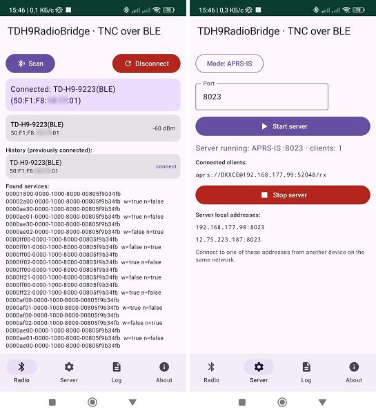

# TDH9RadioBridge · TNC via BLE on Android

[RU](README.md) | [EN](README.en.md) | [Releases](https://github.com/dkxce/tdh9android/releases)   
[Instructions](HOWTO.md) | [Manual](HOWTO.en.md) | [Releases](https://github.com/dkxce/tdh9android/releases)

Bridge between radios**TIDRadio TD-H9**BLE GATT (Odmaster Service)`af00`) and network**TCP/IP**with three protocols. The radio acts as a hardware KISS-TNC: phone
connects via BLE and exchanges with the KISS / AX.25-frame radio, and the application
Raises local TCP servers to which APRS applications and built-in IGate are connected.

**Version:**v1.2. 0

## 1. Opportunities

* **BLE connection**It's like KISS-TNC (service)`0000af00`write`af01`.
  notify`af02`; spare UUIDs`ff02`/`ffe2` и `ff01`/`ffe1`).
* **Three TCP servers**(one at a time, mode choice):
* **Binary Kiss**- port 8023 (raw KISS frames, as serial TNC over the network);
* **AGWPE (Dire Wolf)**Port 8000 (36-byte headers, for UISS/UI-View32/APRSIS32)
* **APRS-IS**Port 14580 (text protocol + passcode verification)
* **foreground**The connection and servers work with the screen turned off.
* **Built-in IGate**Radio щий APRS-IS (incoming and outgoing gates)
* **Built-in Proxy**Proxies APRS and AIS connections to the radio and APRS-IS.
  Filtering rules, autosave settings).
* Built-in coders/decoders**KISS** и **AX.25**(binary ). text).
* RX/TX Log, Customer List, SharedPreferences

## 2. Requirements

* Android Studio (Ladybug 2024.2.1+ is recommended).
* JDK 17.
* Android 8.0+ (API 26)
* Radio TIDRadio TD-H9 or firmware with APRS BLE service.

### 2.1 Minimum requirements for Android devices

* **OS:**Android**8.0 (API 26)**and higher.
* **RAM/CPU:**1 GB of RAM and single-core CPU (the application works on weak devices).
* **Bluetooth:**mandatory**Bluetooth Low Energy (BLE/Bluetooth 4.0+)**.
* **Enabled geolocation service (GPS/"Location")**- mandatory for
  BLE-scan on Android <12 (platform ban, without it there is no radio).
* **Wi-Fi/LAN**It is necessary to connect external APRS clients to TCP servers.
  (Telephone and PC on the same network)
* **Launch permits:**Bluetooth, Geolocation; on Android 13+ – notifications.
* Optional: storage (for logs/settings) - not critical, data is stored
  locally in the application memory.

> **Compatibility check:**Minimum specifications: Android 8.0, BLE 4.0
> geolocation enabled. On devices without geolocation enabled, BLE scanning
> It won’t work – turn on “Location” in your phone settings.

## 3. Assembly

1. Open the folder.`android-bridge`In Android Studio (“Open”).
2. Wait for the first Gradle Sync (downloads Gradle 8.9 and dependencies).
3. Connect your phone with USB debugging enabled.
4. Press.**Run.**().). On the phone, issue Bluetooth permissions and
   Notification (Android 13+)

If Gradle is not synced, update the plugin versions`build.gradle.kts`
и `com.android.application`/`org.jetbrains.kotlin.android`before being used in your
Android Studio.

## 4. Use of use

### 4.1 Quick start: how to connect the radio

1. **Turn on Bluetooth and GPS (geolocation)**on the phone - BLE scanning
   Android requires a location service enabled.
2. **Turn on the radio.**TIDRadio TD-H9 and turn on APRS and Bluetooth
3. In issuing permits**Bluetooth** и **Geolocation**(if not already issued).
4. Open the app.**TDH9RadioBridge**tab**Radio.**press**Scan.**.
5. From the list of found devices, select the radio (or**History**earlier
   Connected - click on it, it will happen**Connect Connect Connect**.
6. It will appear in the log.`[BLE] Connected <имя> (<адрес>)`and a list of GATT services.

### 4.2 Starting the server

1. Go to the tab.**"Server."**.
2. Choose.**regime**(Binary KISS/AGW (AGWPE/APRS-IS) and**port**.
3. Press.**"Run the server."**. They'll be downstairs.**locality**species`192.168.1.5:8023`- it's an address to connect.
4. Connect the APRS application to one of these addresses (phone and client)
   on the same Wi-Fi network.

## 5. Compatibility with APRS applications

| Annex | Protocol | port |
| --- | --- | --- |
| **APRSDroid** | Binary KISS (TNC (KISS), TCP/IP / APRS-IS) | customized |
| **APRSdroid 9M2PJU Mod** | Binary KISS (TNC (KISS), TCP/IP / APRS-IS) | customized |
| **OruxMaps** | APRS-IS | customized |
| **UISS** | AGWPE TCP/IP | 8000 |
| **UI-View32** | AGWPE TCP/IP | 8000 |
| **APRSIS32** | AGWPE (or Binary KISS) | 8000/8023 |
| [**KMZViewer**](https://github.com/dkxce/KMZViewer) | KISS/AGW/APRS-IS | customized |
| [**APRSWin**](https://github.com/dkxce/APRSWin) | Binary KISS/AGW | 8023/8000 |
| [**APRSAir**](https://github.com/dkxce/APRSAIR) | KISS/AGW/APRS-IS | customized |
| [**SimpleAPRSServer**](https://github.com/dkxce/SimpleAPRSServer) | APRS-IS | customized |

> Programmes capable of**AGWP**Set AGW mode (8000); waiting**KISS-TNC**Binary KISS (8023); APRS-IS (14,580)

## 6. Comments

* **The kernel (BLE + KISS + AX.25 + three servers) is fully ported from
  Python project** [dkxce/Tidradio-TD-H9](https://github.com/dkxce/Tidradio-TD-H9/tree/main/TDH9KISS)
* Foreground-service type`connectedDevice`Android 14+ requires permission`FOREGROUND_SERVICE_CONNECTED_DEVICE`(stated in manifesto)

## 7. License and authorship

Programme -**author's project dkxce**https://github.com/dkxce.  
Written for compatibility with TIDRadio TD-H9.

---

## 8. Screenshots

---

**Author**: [dkxcece](https://github.com/dkxce)   
**Android**: [dkxce/tdh9android](https://github.com/dkxce/tdh9android)   
**Desktop**: [dkxce/tdh9desktop](https://github.com/dkxce/tdh9desktop)   
**Manual**: [dkxce/Tidradio-TD-H9](https://github.com/dkxce/Tidradio-TD-H9)