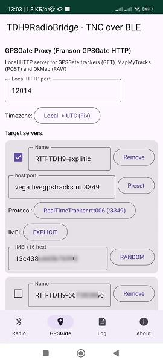
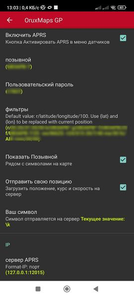
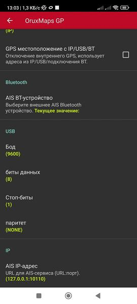
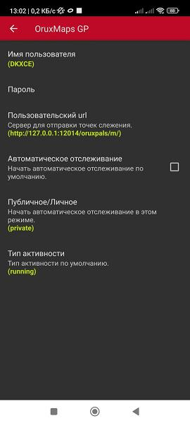
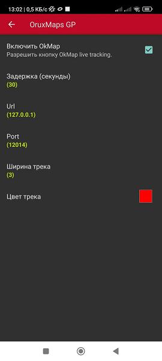
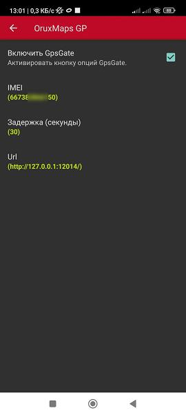

# GPSGate Proxy — настройка и использование (вкладка GPSGate)

**Версия документа:** соответствует приложению **v1.4.0** extended     

Этот документ описывает **одну вкладку** приложения TDH9RadioBridge — **GPSGate Proxy** — и подключение к ней внешних программ (OruxMaps, OkMap). Общее описание приложения — в `HOWTO.md` в корне проекта.

---

## Содержание

- [Что такое GPSGate Proxy](#что-такое-gpsgate-proxy)
- [Описание вкладки](#описание-вкладки)
- [Описание полей](#описание-полей)
- [Описание чекбоксов и переключателей](#описание-чекбоксов-и-переключателей)
- [Описание кнопок](#описание-кнопок)
- [Описание логов](#описание-логов)
- [Поддерживаемые протоколы приёма](#поддерживаемые-протоколы-приёма)
- [Формат исходящих пакетов](#формат-исходящих-пакетов)
- [IMEI: источники формирования](#imei-источники-формирования)
- [Настройка OruxMaps (MapMyTracks)](#настройка-oruxmaps-mapmytracks)
- [Настройка OruxMaps (OkMap)](#настройка-oruxmaps-okmap)
- [Примеры и скриншоты](#примеры-и-скриншоты)

---

## Что такое GPSGate Proxy

**GPSGate Proxy** — локальный сервер приёма позиций от внешних программ (трекеров, навигаторов и конкретно OruxMaps) и их пересылки на **целевые трекер-серверы** в интернете. Приложение принимает позиции по трём протоколам на одном порту (автодетект):

| Протокол | Кто отправляет | Форма |
|----------|----------------|------|
| **GPSGate (HTTP GET)** | GPSGate-совместимые трекеры | `GET /?cmd=$FRCMD,...` |
| **MapMyTracks (HTTP POST)** | OruxMaps и др. | `POST /oruxpals/m/` с телом `request=...&points=...` |
| **OkMap (RAW)** | OkMap/совместимые | TCP-строки `$OKMAP-V01;...` / `$OKMAP-V02;...` / базовые `id;lon;lat;alt;...` |

Автодетект смотрит на первую строку соединения:     
- `GET ` → HTTP GET
- `POST ` → HTTP POST
- `$OKMAP` → OkMap     
Неподдерживаемые соединения закрываются.

---

## Описание вкладки

Вкладка **GPSGate** (иконка геолокации в нижней навигации) содержит:

1. Заголовок и краткое описание сервера.
2. **Local HTTP port** — порт локального сервера (по умолчанию `12014`).
3. **Timezone** — пресет интерпретации времени.
4. **Target servers** — список целевых серверов (до 8), на которые пересылаются позиции.
5. Блок управления и статистики (запущен / остановлен).
6. Блок «Last packets» — лог последних 20 принятых сообщений.

**Схема работы:**

```
OruxMaps / OkMap / GPSGate-трекер
     │   GET/POST/RAW (порт 12014)
     ▼
┌─────────────────────┐
│  GPSGate Proxy      │  ← вкладка GPSGate
│  автоопределяет тип │
└──────┬──────────────┘
       │ rtt006 / MT60 / GL200 (TCP)
       ▼
Target servers
```

---

## Описание полей

### Local HTTP port

| Поле | Описание | По умолчанию |
|------|----------|--------------|
| **Local HTTP port** | TCP-порт, на котором слушает локальный сервер. На него приходят GET/POST/RAW от внешних программ. | `12014` |

> На одном и том же порту принимаются все три протокола (автодетект по первой строке соединения).

### Target servers (серверы назначения)

Каждый сервер — карточка со следующими полями:

| Поле | Описание |
|------|----------|
| **Name** | Произвольное имя сервера (редактируется). Используется для удобства. |
| *(чекбокс)* | Включение/выключение сервера. Выключенные не получают пакеты. |
| **host:port** | Адрес целевого сервера в формате `host:port` (одним полем). |
| **Preset** | Кнопка выбора предустановленного сервера из списка. |
| **Protocol** | Протокол исходящих пакетов: `rtt006`, `MT60`, `GL200`. |
| **IMEI** | Источник формирования IMEI (см. раздел [IMEI](#imei-источники-формирования)). |

**Ограничение:** максимум **8 серверов**; при достижении лимита кнопка **Add server** блокируется.

### Timezone

Пресет интерпретации времени, пришедшего в пакете (поля `DDMMYY`/`HHMMSS` у `?cmd=$FRCMD` ).      
Время из MapMyTracks/OkMap имеет собственную метку и пресетом не изменяется.

| Режим | Назначение |
|-------|------------|
| **UTC -> UTC (No fix)** | Время пакета трактуется как UTC и уходит без изменений. |
| **Local -> UTC (Fix)** (по умолчанию) | Время пакета трактуется как локальное (часовой пояс системы) и переводится в UTC. |
| **UTC -> Local (Fix)** | Время пакета трактуется как UTC и переводится в локальное время системы. |

---

## Описание чекбоксов и переключателей

| Элемент | Где | Описание |
|---------|-----|----------|
| **чекбокс сервера** | Target servers | Включить/выключить пересылку на этот сервер. |
| **Timezone** (выпадающий список) | вкладка GPSGate | Режим интерпретации времени (см. выше). |
| **Protocol** (выпадающий список) | сервер | Протокол исходящих пакетов. |
| **IMEI** (выпадающий список) | сервер | Источник IMEI: `EXPLICIT` / `CRC_TEXT` / `CRC_FRCMD`. |

---

## Описание кнопок

| Кнопка | Где | Действие |
|--------|-----|----------|
| **Start GPSGate Proxy** | вкладка GPSGate | Сохранить настройки и запустить сервер. |
| **Stop GPSGate Proxy** | вкладка GPSGate | Остановить сервер. |
| **Reset stats** | вкладка GPSGate | Сбросить счётчики RX/TX/Failed и лог пакетов. |
| **Add server** | Target servers | Добавить новый целевой сервер (до 8). |
| **Remove** | карточка сервера | Удалить сервер. |
| **Preset** | карточка сервера | Выбрать сервер из предустановленного списка. |
| **RANDOM** | IMEI = EXPLICIT | Сгенерировать случайный 16-символьный hex IMEI. |
| **Clear** (в логе пакетов) | вкладка GPSGate | Очистить лог последних пакетов. |

---

## Описание логов

На вкладке **GPSGate** два места вывода информации:

1. **Кнопка-статистика** при запущенном сервере:
   `Running on :<port>` и счётчики `RX / TX / Failed`.

2. **Last packets** — последние **20** принятых сообщений (новые сверху):
   - для GET — строка запроса `/ ?cmd=...`;
   - для POST — `POST <request> points=<N>` (например `POST update_activity points=3`);
   - для OkMap — `OKMAP <uuid>`.

В общий журнал (вкладка **Log**) пишутся события с префиксами:

| Префикс | Содержание |
|---------|-----------|
| `[GPSGate] proxy started (HTTP :<port>)` | Сервер запущен. |
| `[GPSGate] proxy stopped` | Сервер остановлен. |
| `[GPSGate] connection: <ip>` | Новое TCP-соединение. |
| `[GPSGate] POST <request> points=<N>` | POST-сообщение (всегда, включая stop/get_time с `points=0`). |
| `[GPSGate] OkMap connection` | Соединение распознано как OkMap. |
| `[GPSGate] -> host:port [протокол] OK (imei=...)` | Пакет успешно отправлен на сервер. |
| `[GPSGate!] -> host:port [...] failed (imei=...)` | Не удалось отправить на сервер. |
| `[GPSGate!] -> host:port ERROR: <текст>` | Ошибка при формировании/отправке. |
| `[GPSGate] invalid request: ...` | GET с нераспознанным `cmd`. |
| `[GPSGate] unsupported protocol, closing: ...` | Неизвестный протокол — соединение закрыто. |

**Копирование:** все лог-строки (общий лог, Last packets, вычисленный IMEI) выделяются долгим нажатием и копируются в буфер обмена.

---

## Поддерживаемые протоколы приёма

### 1. GPSGate (HTTP GET)

GPSGate-совместимые трекеры присылают:

```
GET /?cmd=$FRCMD,<sender>,_SendMessage,,<lat>,<N/S>,<lon>,<E/W>,<alt>,<speed_knots>,<heading>,<DDMMYY>,<HHMMSS>,<sats> HTTP/1.1
```

- Путь URL игнорируется — важен только параметр `cmd`.
- Поля после `E/W`: **8 = высота (м), 9 = скорость (узлы), 10 = курс (градусы)**.
- Координаты могут быть в десятичных градусах (`55.7558`) или NMEA (`4435.08340` = 44°35.08340′) — распознаются автоматически.
- На валидный `$FRCMD` сервер отвечает `200 OK`, на невалидный — `400`.

### 2. MapMyTracks (HTTP POST)

OruxMaps и совместимые приложения присылают:

```
POST /oruxpals/m/ HTTP/1.1
Content-Type: application/x-www-form-urlencoded

request=start_activity&...
points=<lat> <lon> <alt> <unix> <lat> <lon> <alt> <unix> ...
```

- Путь игнорируется.
- `points` — группы по 4 значения (`lat lon alt unix`), разделённые пробелами; может быть несколько точек.
- Каждая точка пересылается **отдельным** исходящим пакетом со **своей меткой времени** (unix, как есть), последовательно — от ранней к поздней.
- Ответ — XML-сообщение, ожидаемое OruxMaps (`activity_started`, `activity_stopped`, `server_time` и т.д.).

### 3. OkMap (RAW, TCP)

OkMap и совместимые приложения присылают по TCP строки, разделённые `;`:

```
$OKMAP-V01;<uuid>;<lon>;<lat>;<alt>;<MM/dd/yyyy HH:mm:ss>;<speed>;<bearing>;<newseg>[;...]
$OKMAP-V02;T;<uuid>;<lon>;<lat>;<alt>;<dt>;<speed>;<bearing>;<newseg>[;...]
<id>;<lon>;<lat>;<alt>;<dt>;<speed>;<bearing>[;...]     (базовый формат)
```

- Время — UTC, формат `MM/dd/yyyy HH:mm:ss`.
- Скорость (км/ч) и курс берутся из пакета как есть; `uuid` используется как источник IMEI.
- Каждая строка отправляется как отдельный исходящий пакет.

---

## Формат исходящих пакетов

На каждый целевой сервер позиция пересылается в выбранном протоколе:

| Протокол | Кому подходит | Примечания |
|----------|---------------|------------|
| **rtt006** | rtt и совместимые | `<7-значная длина>rtt006;<imei>;<данные>` |
| **MT60** (Meitrack) | серверы Meitrack | `$MGV002,<imei>,...` |
| **GL200** (Queclink) | серверы Queclink | `+RESP:GTFRI,301201,<imei>,...` |

Пакет отправляется на **все включённые** серверы в своём формате (каждому серверу — его протокол и его IMEI).

---

## IMEI: источники формирования

Для каждого сервера независимо настраивается источник IMEI (`IMEI` в карточке сервера):

| Источник | Описание |
|----------|----------|
| **EXPLICIT** | Поле ввода: 16 hex-символов (0-9a-f) вручную. Кнопка **RANDOM** генерирует случайный. |
| **CRC_TEXT** | CRC-64/ECMA-182 от текста, введённого пользователем. Вычисленный IMEI показывается под полем и копируется. |
| **CRC_FRCMD** (по умолчанию) | CRC-64/ECMA-182 от sender-id пакета. Что именно берётся за sender-id — зависит от протокола, см. таблицу ниже. |

### CRC-64/ECMA-182 от sender-id (источник CRC_FRCMD)

Алгоритм: **CRC-64/ECMA-182** (полином `0x42F0E1EBA9EA3693`), отражённый; результат — 16 символов lowercase hex.

| Протокол приёма | Откуда берётся sender-id | Пример |
|-----------------|--------------------------|--------|
| **GPSGate (GET)** | 2-е поле пакета `$FRCMD,<sender>,...` (числовой идентификатор трекера) | sender `667383866150` → `2dcf8dae5e3e49bd` |
| **OkMap (RAW)** | `uuid` устройства — первое поле после версии (`$OKMAP-V01;<uuid>;...`, `$OKMAP-V02;T;<uuid>;...`, базовый `<id>;...`) | uuid `031fd58f-2dba-41c6-97fe-02c29f1fc730` → `5a60b323593588db` |
| **MapMyTracks (POST)** | sender-id в протоколе отсутствует → берётся пустая строка | `""` → `0000000000000000` |

> Для MapMyTracks все POST-точки получают одинаковый IMEI (`CRC64("")`). Если нужен осмысленный IMEI — выберите источник `EXPLICIT` или `CRC_TEXT`.

---

## Настройка OruxMaps (APRS)

1. На вкладке **Server** или **IGate** приложения запустите сервер или шлюз.
2. Откройте OruxMaps: **настройки → Датчики → APRS** (экран «APRS»):
   - **Включить APRS** — вкл;
   - **позывной** и **Пользовательский пароль** — свой радиолюбительский позывной и passcode;
   - **Отправить свою позицию** — вкл;
   - **сервер APRS** — `IP:порт` телефона (например `127.0.0.1:12015`, *см. примечание*);
3. Запустите APRS в OruxMaps — точки пойдут на прокси и далее на серверы назначения.
  
## Настройка OruxMaps (AIS)

1. На вкладке **Server** или **IGate** приложения запустите сервер или шлюз.
2. Откройте OruxMaps: **настройки → Датчики → AIS** (экран «AIS»):
   - **Включить AIS** — вкл;
   - **AIS IP-адрес** — `IP:порт` телефона (например `127.0.0.1:10110`, *см. примечание*);
3. Запустите APRS в OruxMaps — точки пойдут на прокси и далее на серверы назначения. 

## Настройка OruxMaps (MapMyTracks)

1. На вкладке **GPSGate** приложения запустите прокси (**Start GPSGate Proxy**).
2. Откройте OruxMaps: **настройки → Интеграция → MapMyTracks** (экран «MapMyTracks»):
   - **Имя пользователя** — свой радиолюбительский позывной;
   - **Пароль** — passcode;
   - **Пользовательский url** — `http://127.0.0.1:12014/`;
   - **Публичное/Личное** — любой;
   - **Тип активности** — любой.
3. Запустите трек в OruxMaps — точки пойдут на прокси и далее на серверы назначения.

## Настройка OruxMaps (OkMap)

1. На вкладке **GPSGate** приложения запустите прокси (**Start GPSGate Proxy**).
2. Откройте OruxMaps: **настройки → Интеграция → OkMap** (экран «OkMap»):
   - **Включить OkMap** — вкл;
   - **Задержка (секунды)** — например `30`;
   - **Url** — IP телефона (например `127.0.0.1`);
   - **Port** — `12014` (порт прокси);
   - **Ширина трека**, **Цвет трека** — по желанию.
3. Начните запись трека в OkMap — строки `$OKMAP-...` пойдут на прокси, а оттуда на серверы назначения.

## Настройка OruxMaps (GpsGate)

1. На вкладке **GPSGate** приложения запустите прокси (**Start GPSGate Proxy**).
2. Откройте OruxMaps: **настройки → Интеграция → OkMap** (экран «OkMap»):
   - **Включить GpsGate** — вкл;
   - **IMEI** — любое число до 15 знаков;
   - **Задержка (секунды)** — например `30`;
   -  **Url** — `http://127.0.0.1:12014/`;
3. Начните запись трека в GpsGate — строки `?cmd=` пойдут на прокси, а оттуда на серверы назначения.

---

## Примеры и скриншоты

Скриншоты настроек лежат в папке `images/` рядом с этим документом:

| Скриншот | Что изображено |
|----------|----------------|
|  | Вкладка GPSGate Proxy: порт, Timezone, список серверов (Name/host:port/Protocol/IMEI) |
|  | OruxMaps — Настройки APRS (позывной, пароль, фильтры, сервер APRS `127.0.0.1:12015`) |
|  | OruxMaps — Настройки AIS (IP-адрес `127.0.0.1:10110`) |
|  | OruxMaps — Настройки MapMyTracks (имя пользователя, пароль, url `http://127.0.0.1:12014/`) |
|  | OruxMaps — Настройки OkMap (задержка `30`, url `127.0.0.1`, port `12014`) |
|  | OruxMaps — Настройки GPSGate (задержка `30`, imei, url `http://127.0.0.1:12014/`) |